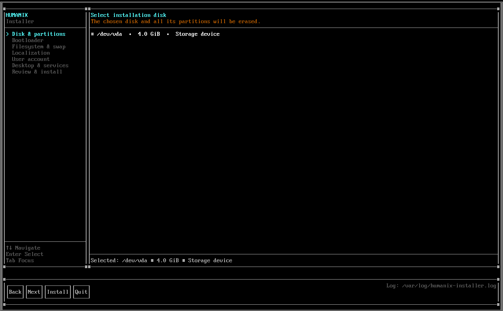
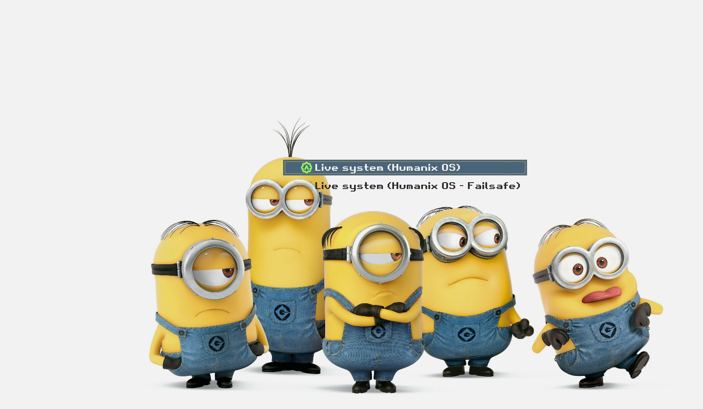

#  Humanix GNU/Linux

Humanix is a small Linux system. It is based on Debian Trixie.
It is made for daily use and for learning.
You can change a real Linux system and see how it works.

Humanix starts from a live ISO.
It ships its own command shell, system tools, and a disk installer.

---

## Included Tools

- `dish` — the Humanix command shell. C++17, termios line editor, fork/exec, pipes, aliases, history, tab completion.
- `humanix-doctor` — checks common system problems. C++, sys/statvfs, sys/sysinfo, systemd and APT state.
- `upm` — installs and manages packages. Go, cobra CLI.
- `sys-sentinel` — system status daemon. C++, epoll, AF_UNIX socket at `/run/humanix-sentinel.sock`.
- `sentinel-ctl` — control client for `sys-sentinel`. C++, AF_UNIX client.
- `humanix-installer` — installs Humanix to a disk (TUI). C++17, FTXUI, parted, rsync, chroot, GRUB EFI.

Humanix is Debian-based, so APT/dpkg remain authoritative for Debian system packages and dependencies. UPM is an additional manager for Humanix-specific packages and explicitly selected isolated foreign packages; Debian repositories are not enabled in its defaults.

---

## Get the ISO

ISO files are built by GitHub Actions.

1. Open the **Actions** tab.
2. Choose **Build Humanix Live ISO**.
3. A build started from the `main` branch is saved as a workflow artifact.

---

## Install Safely

Please read this before you install.

- The installer erases every partition on the selected disk.
- It targets UEFI systems and installs GRUB. Boot the live USB in UEFI mode.
- Try it in a virtual machine first.
- Or use an empty disk.
- Back up any files you need before installing.

---

## About This Project

Humanix is a personal project.
You can read and change its configuration and source code in this repository.

## Screenshots

